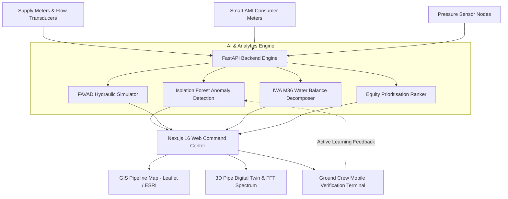

# 🌊 AquaSentry: AI-Powered Water Intelligence & Infrastructure Optimisation

[](https://github.com/Nandan-Bomale/AquaSentry)
[-0080ff.svg)](https://nextjs.org/)
[](https://fastapi.tiangolo.com/)
[](https://scikit-learn.org/)
[](https://leafletjs.com/)
[](LICENSE)

> **"Every drop accounted for. Every decision optimised. Every community considered."**

---

## 📌 Executive Summary & Problem Context

In urban municipal grids like Bangalore (**BWSSB**), over **100 Million Litres** of clean drinking water enter the distribution network daily. Yet **22% to 25% of treated water vanishes** before it reaches a billed tap. 

### Why Conventional Utility Monitoring Fails:
- **Invisible Physical Leaks:** Pipes buried 2 meters underground burst silently, leaking for months without surface pooling.
- **Complaint-Led Bias:** Traditional repairs only respond when affluent neighborhoods complain; underserved communities suffer quietly.
- **Data Fragmentation:** Meter readings, SCADA flow sensors, and billing ledgers sit in disconnected silos.

**AquaSentry** is an end-to-end **Enterprise Water SCADA & Digital Twin Intelligence Platform** that combines **unsupervised machine learning**, **IWA-standard water audits**, and **hydrodynamic physics** to turn invisible water loss into financially prioritized, equity-weighted repair actions.

---

## 🚀 Key Modules & Platform Capabilities

| Module | Route | Highlights |
|---|---|---|
| **Operations Overview** | `/dashboard` | Live SCADA overview: 8 KPI scorecards, 30-day supply vs billed consumption area charts, live AI alarm stream. |
| **GIS Pipeline Network Map** | `/map` | Leaflet GIS cartography following Bangalore corridors (450 km) with animated fluid flow pulses, PRVs, pumps, and pulsing acoustic leak beacons. |
| **3D Pipe Digital Twin** | `/digital-twin` | **Hydrodynamic cross-section**: Hagen-Poiseuille parabolic velocity streamlines, internal tuberculation corrosion crust, ultrasonic wall thickness NDT, and real-time acoustic FFT spectrum analyzer (with Web Audio leak hydrophone sound). |
| **AI Anomaly Detection** | `/anomalies` | Scikit-learn **Isolation Forest** model evaluating Minimum Night Flow (MNF), pressure dips, and multi-class loss categorization (Physical Leak vs Meter Drift vs Theft vs Data Delay). |
| **IWA Standard Water Balance** | `/water-balance` | Official **IWA / AWWA M36** standard balance matrix decomposing 100 MLD System Input into Revenue Water vs Apparent Commercial vs Real Physical Losses + ILI index calculator. |
| **Repair Prioritisation** | `/priority` | 100-point multi-factor rank integrating Volume Loss (25), Infrastructure Risk (25), **Community Vulnerability (20)**, Confidence (15), and Urgency (15). |
| **Field Crew Dispatch** | `/field-dispatch` | **Human-in-the-Loop Ground Verification terminal**: GPS team dispatch, hydrophone acoustic dB input, excavation depth logs, and active learning feedback loop. |
| **Hydraulic Sandbox** | `/simulation` | 24-hour diurnal FAVAD pressure-leak simulator ($Q_{leak} = C \cdot P^{1.15}$), night PRV modulation, and carbon footprint reduction. |
| **Impact & ESG Analytics** | `/impact` | 12.7 ML verified water recovered, ₹39.4 Lakh saved, 42 hr → 18.4 hr response time reduction, and community equity metrics. |
| **Meter Health & QA** | `/data-quality` | Telemetry ingestion lag tracking, zero-read cluster anomaly flags, and billing reconciliation audit. |

---

## 🛠️ Architecture & Tech Stack



### Frontend:
- **Framework:** Next.js 16 (App Router & Turbopack)
- **Language:** TypeScript
- **Styling:** Tailwind CSS v4 + Custom Dark Glassmorphism SCADA Theme
- **Data Visualisation:** Recharts 3, D3.js
- **GIS Cartography:** Leaflet.js with ESRI Dark Gray Base Canvas
- **Acoustic Audio:** Web Audio API (Synthesizing pressurized leak resonance)

### Backend & Machine Learning:
- **Framework:** FastAPI (Python 3.11) + Uvicorn
- **Machine Learning:** `scikit-learn` (IsolationForest, StandardScaler)
- **Data Manipulation:** `pandas`, `numpy`, `scipy`
- **Hydraulic Modeling:** Fixed and Variable Area Discharges (FAVAD) principles

---

## ⚡ Quick Start & Installation

### Option 1: One-Click Launch (Windows)
Simply double-click the included batch launcher:
```bat
START_AQUASENTRY.bat
```
This automatically starts the FastAPI backend, compiles the Next.js frontend, and launches the browser to `http://localhost:3000`.

---

### Option 2: Manual Terminal Startup

#### 1. Start the AI Backend:
```bash
cd aquasentry-backend
pip install fastapi uvicorn scikit-learn numpy pandas scipy
python -m uvicorn main:app --host 0.0.0.0 --port 8000 --reload
```
- API Endpoint: `http://localhost:8000`
- Interactive Swagger Docs: `http://localhost:8000/docs`

#### 2. Start the Next.js Frontend:
```bash
cd aquasentry
npm install
npm run dev
```
- Frontend Web App: `http://localhost:3000`

---

## 📊 IWA Standard Water Balance Decomposition

Based on the International Water Association (IWA) and American Water Works Association (AWWA) M36 standard:

$$\text{System Input Volume (100 MLD)} = \text{Authorised Consumption (77.6 MLD)} + \text{Water Losses (22.4 MLD)}$$

$$\text{Water Losses (22.4 MLD)} = \underbrace{\text{Real Losses (16.0 MLD)}}_{\text{Physical Pipe Bursts}} + \underbrace{\text{Apparent Losses (6.4 MLD)}}_{\text{Commercial Theft \& Meter Inaccuracy}}$$

$$\text{Infrastructure Leakage Index (ILI)} = \frac{\text{Current Annual Real Losses (CARL)}}{\text{Unavoidable Annual Real Losses (UARL)}} = \frac{16.0}{4.2} = \mathbf{3.81} \text{ (Band B)}$$

---

## 🏆 Hackathon Defense & Judging Highlights

1. **Not a Generic AI Wrapper:** Includes real Scikit-learn unsupervised machine learning pipelines running live multivariate anomaly scoring.
2. **Ultra-Realistic GIS & Fluid Visualization:** Multi-waypoint pipe corridors following actual Bangalore arterial highways (Outer Ring Rd, Hosur Rd, Bellary Rd), pulsating leak beacons, and a 3D digital twin cross-section with Poiseuille streamlines.
3. **Equity-Weighted Prioritization:** Community vulnerability accounts for 20% of the priority score, preventing repair bias towards affluent wards.
4. **Human-in-the-Loop Active Learning:** Field crew ground verification feeds back into model retraining.

---

## 👥 Authors & Team
- **MANTHAN 2.0 Hackathon** | Round 2 (Develop) & Round 3 (Defend)
- **Challenge 06:** The Water Loss No One Can See
- **Repository:** [https://github.com/Nandan-Bomale/AquaSentry](https://github.com/Nandan-Bomale/AquaSentry)
